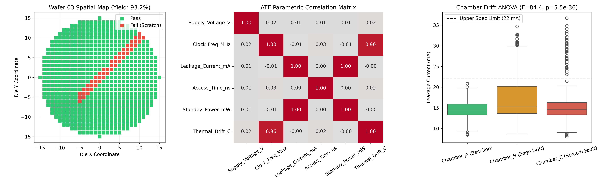

# Semiconductor ATE Wafer Map Analytics & Test-Time Optimization Engine

An end-to-end post-silicon test analytics system built in Python to diagnose spatial wafer defect signatures, monitor fabrication chamber drift via **One-Way ANOVA**, audit **Process Capability ($C_{pk}$)**, and eliminate redundant Automated Test Equipment (ATE) tests using **Pearson Correlation**.



## Engineering Problem & Business Impact
In high-volume semiconductor testing, Automated Test Equipment (ATE) machine time is a primary driver of unit manufacturing cost, while undiagnosed physical wafer defects cause severe yield loss. This pipeline solves four core test-engineering challenges:
1. **Chamber Drift Detection (One-Way ANOVA):** Statistically isolates drifting fabrication chambers across multi-wafer lots ($F = 84.38, p = 5.47 \times 10^{-36}$).
2. **Six Sigma Process Capability ($C_{pk}$) Auditing:** Automatically flags out-of-spec parametric distributions (`Leakage_Current_mA` at $C_{pk} = 0.48$, `Clock_Freq_MHz` at $C_{pk} = 1.27$) against the $C_{pk} \ge 1.33$ industry benchmark.
3. **ATE Test-Time & Cost Reduction:** Identifies highly correlated electrical tests ($|r| > 0.95$)—eliminating redundant `Standby_Power_mW` ($r = 1.00$) and `Thermal_Drift_C` ($r = 0.96$) measurements to cut probe time by **33.3%** (**472.7 ATE hours / ~$136K annual savings** per 10,000 wafers).
4. **Spatial Defect Signature Classification:** Extracts geometric features (`Radius` and diagonal offset $|X - Y|$) on failing dies to classify **Edge-Ring Etch Drift** vs. **Robotic Handling Scratches** with **92.45% test accuracy** in `0.29s`.

## How to Run Locally
```bash
git clone https://github.com<your-username>/semiconductor-ate-wafer-analytics.git
cd semiconductor-ate-wafer-analytics
pip install -r requirements.txt
python wafer_ate_analytics.py
```

## Tech Stack
* **Languages & Libraries:** Python, Pandas, NumPy, SciPy, Scikit-learn, Matplotlib, Seaborn
* **Statistical & ML Methods:** One-Way ANOVA (`f_oneway`), Pearson Correlation Matrix, Process Capability ($C_{pk}$), Spatial Feature Engineering, Random Forest Classification
